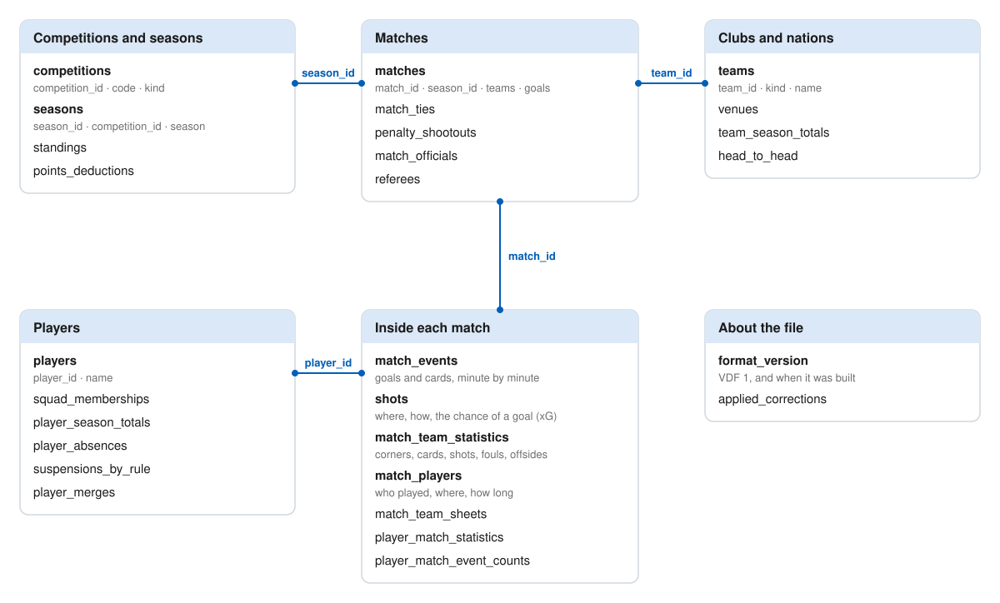

# 11footy football dataset

Football matches, events, shots, line-ups and statistics: the five top European leagues and
their second divisions, the three UEFA club cups, and national-team football. Rebuilt in full
after each round of matches. Free for non-commercial use under CC BY-NC 4.0 (see `LICENSE`);
credit "11footy".

## The tables at a glance

<picture>
  <source media="(prefers-color-scheme: dark)" srcset="https://github.com/fm-devlab/11footy-dataset/raw/main/assets/dataset-tables-dark.svg">
  
</picture>

Every column is listed at the end of this file; `docs/VESTA_DATA_FORMAT.md` gives the rules
Vesta reads them by.

## The files

Every file is a SQLite database (`.db.xz`, compressed with xz) and the same data as CSV
(`.csv.zip`, one CSV per table). Pick the files you need, or the whole dataset in one file. A file's name is its
folder and its competition (`italy.serie-a.db.xz`).

| File | Holds |
|---|---|
| `italy.serie-a`, `italy.serie-b` | Serie A, Serie B |
| `england.premier-league`, `england.championship` | Premier League, Championship |
| `spain.la-liga`, `spain.segunda` | La Liga, Segunda División |
| `germany.bundesliga`, `germany.2-bundesliga` | Bundesliga, 2. Bundesliga |
| `france.ligue-1`, `france.ligue-2` | Ligue 1, Ligue 2 |
| `european-cups.champions-league` | the Champions League with its qualifying rounds |
| `european-cups.europa-league` | the Europa League with its qualifying rounds |
| `european-cups.conference-league` | the Conference League with its qualifying rounds |
| `european-cups.super-cup` | the UEFA Super Cup |
| `nations` | every national-team competition: World Cup, continental championships, qualifiers, nations leagues, friendlies |
| `players` | every player |
| `11footy` | everything above in one file |

- Every file opens on its own: it holds the competitions, seasons, teams, venues and referees
  its matches need. Players appear as `player_id` only; their names are in `players`.
- Ids are ours and global: the same team, player or match has the same id in every file and
  from one release to the next. Any set of files joins on them. A match is in exactly one split
  file. Use either the split files or `11footy`, not both: together they hold every match twice.
- When two player ids turn out to be one person, the higher id is retired for good;
  `player_merges` lists which retired id became which.
- Each file's `format_version` row says what it is: `version` (`VDF 1`), `dataset`
  (`11footy`), `part` (`italy/serie-a`, `players`, `all`), `scope` (the competition codes it
  holds), `built_at` (the release's build, the same in every file of one release) and `licence`.
- Every match row carries its competition: `competition_code` and `competition_name`.
- `matches.matchday` in a league: the round of the published fixture list where we hold it;
  otherwise derived, a match being round n when it is the n-th match of both its clubs that
  season. A match moved out of its round (postponed and played later) then has no matchday.
- `SHA256SUMS` lists every file of the release with its SHA-256, and every database once
  unpacked (`11footy.db`); `SHA256SUMS.sig` signs it (OpenSSH, namespace `11footy-dataset`).
  Check what you downloaded with `sha256sum -c --ignore-missing SHA256SUMS`.
- `schema.sql` holds every table and view as the files declare them; it builds an empty
  dataset (`sqlite3 empty.db < schema.sql`). The columns are also listed at the end of this file.

### CSV conventions

UTF-8, comma-separated, a header row, an empty field for an unknown value (NULL), `.` as the
decimal mark, dates and times in ISO 8601 (`2025-08-16`, `2025-08-16T14:00:00Z`, always UTC).

## Layers: why some facts come twice

Some facts are counted by two different conventions. Both are kept, each row labelled with
its `layer`, so you can choose; the default for analysis is given for each.

### Team statistics (`match_team_statistics.layer`)

- `report`: the counts of the official match report: shots, shots on target, corners, fouls,
  yellow and red cards. Leagues only.
- `feed`: the counts of the live match feed: the same items plus offsides, possession, passes,
  tackles and more. Leagues, cups and national teams.

The two conventions differ (what counts as a shot, for instance), so a match can have two
different shot counts and both are right by their own rule. **Default: `report` in the
leagues, `feed` where it is the only one.** Cups and national-team matches have `feed` only.
A `feed` row whose fouls and corners are 0 for both sides was not counted: treat it as unknown.

```sql
-- one row per match and team: the report where there is one, else the feed
SELECT s.*
FROM match_team_statistics s
WHERE s.layer = 'report'
   OR NOT EXISTS (SELECT 1 FROM match_team_statistics r
                  WHERE r.match_id = s.match_id AND r.team_id = s.team_id
                    AND r.layer = 'report');

-- offsides exist in the feed only
SELECT match_id, team_id, offsides FROM match_team_statistics WHERE layer = 'feed';
```

### Match events (`match_events.layer`)

- `summary`: the key events of a match: goals, cards, substitutions.
- `play_by_play`: the running account of the match, minute by minute: attempts, fouls,
  corners, offsides, as well as the goals and cards again.
- `correction`: our own fixes where the sources were wrong.

A goal is usually in both `summary` and `play_by_play`. **Read goals and cards from one
layer: `correction` over `summary` over `play_by_play`.** Use `play_by_play` for everything
else (attempts, fouls, corners).

```sql
-- the goals of a match, each once
SELECT * FROM match_events e
WHERE e.match_id = :match AND e.kind IN ('goal', 'penalty_goal', 'own_goal')
  AND e.layer = (SELECT CASE WHEN sum(layer = 'correction') > 0 THEN 'correction'
                             WHEN sum(layer = 'summary') > 0 THEN 'summary'
                             ELSE 'play_by_play' END
                 FROM match_events WHERE match_id = :match
                   AND kind IN ('goal', 'penalty_goal', 'own_goal'));

-- fouls of a match, from the running account
SELECT team_id, count(*) FROM match_events
WHERE match_id = :match AND layer = 'play_by_play' AND kind = 'foul' GROUP BY team_id;
```

### Shots (`shots.layer`)

- `tracked`: shot-by-shot data where every shot has its position on the pitch and its
  context. The five top leagues.
- `commentary`: shots read from the running account; a position when the account gives one
  ("from the left side of the box"), else none.

A shot is in one layer only: the `tracked` row when there is one (`also_in_commentary` = 1
says the running account names it too), else the `commentary` row. **Default: every row;
filter `layer = 'tracked'` when you need every shot to have a position.**

```sql
-- every shot of a match
SELECT * FROM shots WHERE match_id = :match;

-- shots with a position only
SELECT x_m, y_m, result FROM shots WHERE layer = 'tracked';
```

Positions are in metres on a 105 x 68 pitch: `x_m` from 0 (the shooter's own goal line) to 105
(the goal attacked), `y_m` from 0 (the attacker's left touchline) to 68; the goal attacked is
centred at (105, 34). `xg` is the chance the shot was a goal, from 11footy's own model.

## Players' current club

`players.current_team_id`, `current_team_name` and `team_as_of` give each player's club now:
the club of his latest club appearance or squad membership, whichever is newer, dated by that
evidence, when it falls within the 12 months before the build. A national team never counts.
Otherwise `current_team_id` is empty and `current_team_name` is `n/a`: the player has not been
seen at a club of this dataset in the last 12 months. He may have retired, be without a club,
or play in a league this dataset does not hold; most players of the national-team matches play
in such leagues.

## Unknown is empty

An empty value (NULL) means unknown, never zero: a 0 is a count of zero.

## Tables and columns

Every file holds the tables below that its part needs; the CSV zip of a file has
one `<table>.csv` per table, with these columns in this order.

- **applied_corrections**: `match_id` (integer), `fact` (text), `value_before` (text), `value_after` (text), `applied_at` (text)
- **competitions**: `competition_id` (integer), `code` (text), `name` (text), `country` (text), `kind` (text), `time_zone` (text), `first_season` (integer), `tier` (integer)
- **format_version**: `version` (text), `dataset` (text), `part` (text), `scope` (text), `built_at` (text), `licence` (text)
- **head_to_head**: `team_id_a` (integer), `team_id_b` (integer), `competition_id` (integer), `matches` (integer), `wins_a` (integer), `draws` (integer), `wins_b` (integer), `goals_a` (integer), `goals_b` (integer), `last_match_id` (integer)
- **match_events**: `event_id` (integer), `match_id` (integer), `sequence` (integer), `period` (integer), `minute` (integer), `added_minute` (integer), `clock_seconds` (integer), `wall_clock_utc` (text), `kind` (text), `detail` (text), `team_id` (integer), `related_team_id` (integer), `player_id` (integer), `related_player_id` (integer), `shot_id` (integer), `score_home_after` (integer), `score_away_after` (integer), `layer` (text)
- **match_officials**: `match_id` (integer), `referee_id` (integer), `role` (text)
- **match_players**: `match_id` (integer), `team_id` (integer), `player_id` (integer), `started` (integer), `on_bench` (integer), `shirt_number` (integer), `position_code` (text), `position_group` (text), `formation_slot` (integer), `minute_on` (integer), `minute_off` (integer), `minutes_played` (integer), `sent_off` (integer)
- **match_team_sheets**: `match_id` (integer), `team_id` (integer), `formation` (text), `captain_player_id` (integer), `starters_count` (integer), `bench_count` (integer)
- **match_team_statistics**: `match_id` (integer), `team_id` (integer), `layer` (text), `shots` (integer), `shots_on_target` (integer), `shots_blocked` (integer), `corners` (integer), `fouls` (integer), `offsides` (integer), `yellow_cards` (integer), `red_cards` (integer), `possession_percent` (real), `passes` (integer), `accurate_passes` (integer), `crosses` (integer), `accurate_crosses` (integer), `long_balls` (integer), `accurate_long_balls` (integer), `tackles` (integer), `effective_tackles` (integer), `interceptions` (integer), `clearances` (integer), `effective_clearances` (integer), `saves` (integer), `penalties_taken` (integer), `penalties_scored` (integer), `woodwork` (integer)
- **match_ties**: `tie_id` (integer), `season_id` (integer), `stage` (text), `first_leg_match_id` (integer), `second_leg_match_id` (integer), `winner_team_id` (integer), `decided_by` (text)
- **matches**: `match_id` (integer), `season_id` (integer), `competition_code` (text), `competition_name` (text), `stage` (text), `group_name` (text), `league_name` (text), `matchday` (integer), `leg` (integer), `tie_id` (integer), `kickoff_utc` (text), `kickoff_precision` (text), `local_date` (text), `home_team_id` (integer), `away_team_id` (integer), `neutral_venue` (integer), `venue_id` (integer), `attendance` (integer), `status` (text), `home_goals` (integer), `away_goals` (integer), `home_goals_on_pitch` (integer), `away_goals_on_pitch` (integer), `home_goals_half_time` (integer), `away_goals_half_time` (integer), `home_goals_regular_time` (integer), `away_goals_regular_time` (integer), `extra_time_played` (integer), `shootout_home_goals` (integer), `shootout_away_goals` (integer), `winner_team_id` (integer)
- **penalty_shootouts**: `match_id` (integer), `sequence` (integer), `team_id` (integer), `player_id` (integer), `scored` (integer)
- **player_absences**: `absence_id` (integer), `player_id` (integer), `team_id` (integer), `kind` (text), `certainty` (text), `from_date` (text), `expected_until` (text), `ended_on` (text), `sources_count` (integer), `recorded_at` (text), `basis` (text)
- **player_match_event_counts**: `match_id` (integer), `team_id` (integer), `player_id` (integer), `attempts` (integer), `attempts_on_target` (integer), `attempts_blocked` (integer), `attempts_off_target` (integer), `attempts_woodwork` (integer), `attempts_inside_box` (integer), `attempts_outside_box` (integer), `headed_attempts` (integer), `goals` (integer), `assists` (integer), `penalties_taken` (integer), `penalties_scored` (integer), `penalties_won` (integer), `penalties_conceded` (integer), `fouls_committed` (integer), `fouls_suffered` (integer), `offsides` (integer), `corners_conceded` (integer), `yellow_cards` (integer), `red_cards` (integer), `substituted_on_minute` (integer), `substituted_off_minute` (integer), `big_chances` (integer)
- **player_match_statistics**: `match_id` (integer), `team_id` (integer), `player_id` (integer), `minutes_played` (integer), `goals` (integer), `assists` (integer), `own_goals` (integer), `shots` (integer), `shots_on_target` (integer), `key_passes` (integer), `fouls_committed` (integer), `fouls_suffered` (integer), `yellow_cards` (integer), `red_cards` (integer), `saves` (integer), `goals_conceded` (integer), `shots_faced` (integer), `offsides` (integer), `appeared` (integer), `came_on` (integer)
- **player_merges**: `retired_id` (integer), `kept_id` (integer), `merged_on` (text)
- **player_season_totals**: `season_id` (integer), `team_id` (integer), `player_id` (integer), `appearances` (integer), `starts` (integer), `minutes` (integer), `goals` (integer), `assists` (integer), `own_goals` (integer), `shots` (integer), `shots_on_target` (integer), `key_passes` (integer), `fouls_committed` (integer), `fouls_suffered` (integer), `yellow_cards` (integer), `red_cards` (integer), `saves` (integer), `goals_conceded` (integer), `attempts` (integer), `attempts_on_target` (integer), `penalties_taken` (integer), `penalties_scored` (integer)
- **players**: `player_id` (integer), `name` (text), `short_name` (text), `birth_date` (text), `usual_position_group` (text), `current_team_id` (integer), `current_team_name` (text), `team_as_of` (text)
- **points_deductions**: `season_id` (integer), `team_id` (integer), `points` (integer), `effective_on` (text)
- **referees**: `referee_id` (integer), `name` (text), `country` (text)
- **seasons**: `season_id` (integer), `competition_id` (integer), `season` (integer), `name` (text), `first_match_on` (text), `last_match_on` (text), `teams_count` (integer), `status` (text), `format` (text), `matchdays_total` (integer)
- **shots**: `shot_id` (integer), `match_id` (integer), `team_id` (integer), `player_id` (integer), `assist_player_id` (integer), `period` (integer), `minute` (integer), `added_minute` (integer), `x_m` (real), `y_m` (real), `goal_mouth_y` (real), `result` (text), `situation` (text), `body_part` (text), `is_penalty` (integer), `distance_m` (real), `angle_degrees` (real), `zone` (text), `zone_side` (text), `layer` (text), `also_in_commentary` (integer), `xg` (real)
- **squad_memberships**: `player_id` (integer), `team_id` (integer), `from_date` (text), `to_date` (text), `shirt_number` (integer)
- **standings**: `season_id` (integer), `after_matchday` (integer), `team_id` (integer), `played` (integer), `won` (integer), `drawn` (integer), `lost` (integer), `goals_for` (integer), `goals_against` (integer), `goal_difference` (integer), `points` (integer), `position` (integer), `points_deducted` (integer), `league_name` (text), `group_name` (text), `form_last_five` (text)
- **suspensions_by_rule**: `player_id` (integer), `team_id` (integer), `competition_id` (integer), `trigger_event_id` (integer), `rule_id` (text), `matches_banned` (integer), `served_in_match_ids` (text), `certainty` (text), `yellow_cards_accumulated` (integer)
- **team_season_totals**: `season_id` (integer), `team_id` (integer), `matches_played` (integer), `won` (integer), `drawn` (integer), `lost` (integer), `goals_for` (integer), `goals_against` (integer), `clean_sheets` (integer), `failed_to_score` (integer), `home_won` (integer), `home_drawn` (integer), `home_lost` (integer), `away_won` (integer), `away_drawn` (integer), `away_lost` (integer), `home_matches_played` (integer), `home_goals_for` (integer), `home_goals_against` (integer), `home_clean_sheets` (integer), `home_failed_to_score` (integer), `away_matches_played` (integer), `away_goals_for` (integer), `away_goals_against` (integer), `away_clean_sheets` (integer), `away_failed_to_score` (integer), `shots` (integer), `shots_on_target` (integer), `corners` (integer), `fouls` (integer), `offsides` (integer), `yellow_cards` (integer), `red_cards` (integer)
- **teams**: `team_id` (integer), `name` (text), `short_name` (text), `kind` (text), `country` (text), `city` (text), `founded_year` (integer), `refounded_on` (text), `active_from` (text), `active_to` (text), `colour` (text), `alternate_colour` (text), `colour_luminance` (real), `alternate_colour_luminance` (real)
- **venues**: `venue_id` (integer), `name` (text), `city` (text), `country` (text), `capacity` (integer), `home_team_id` (integer)
